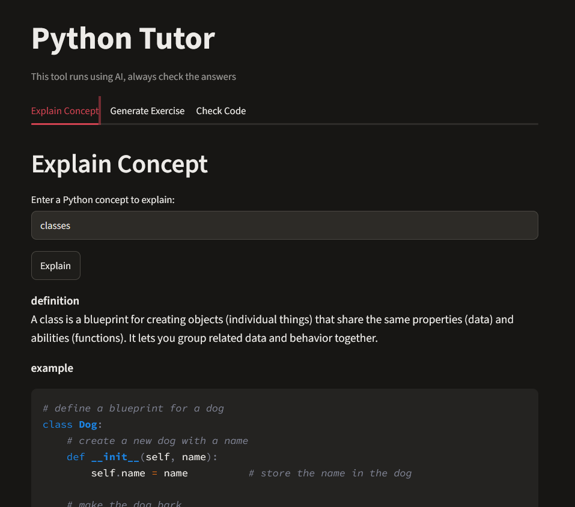
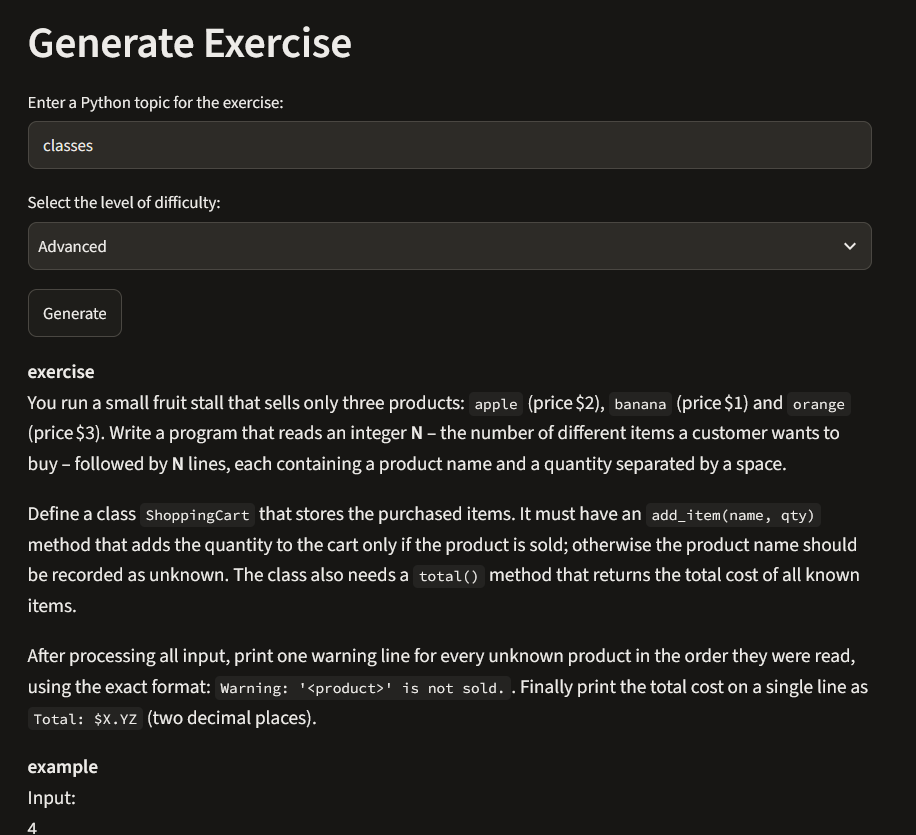
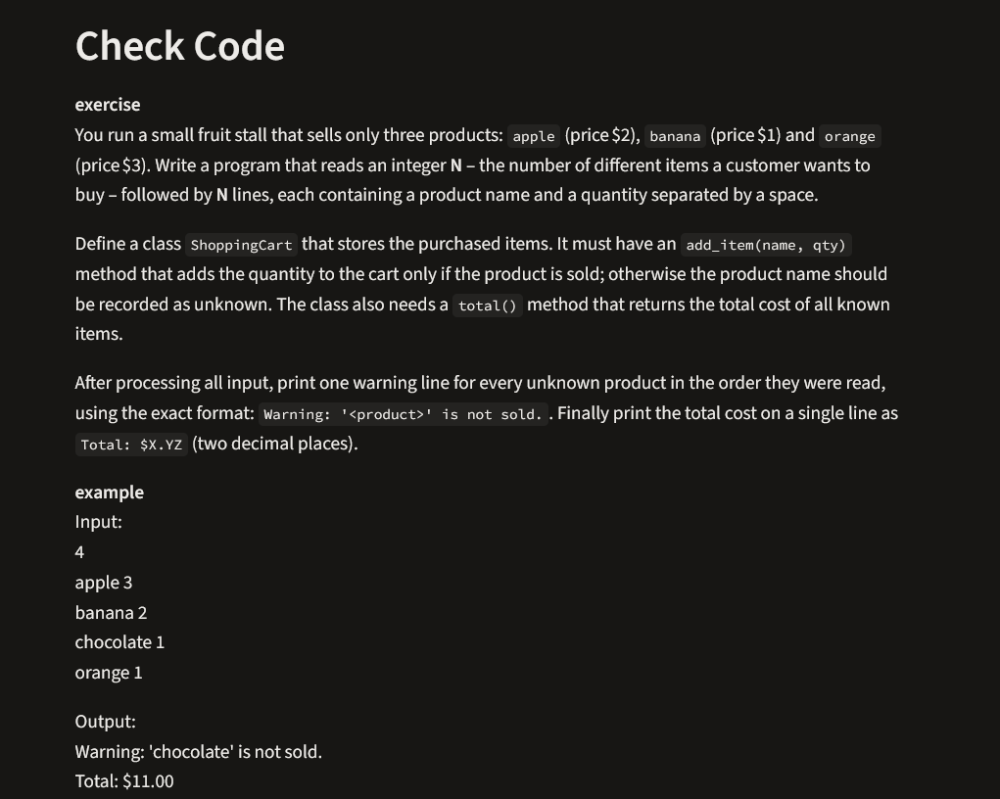
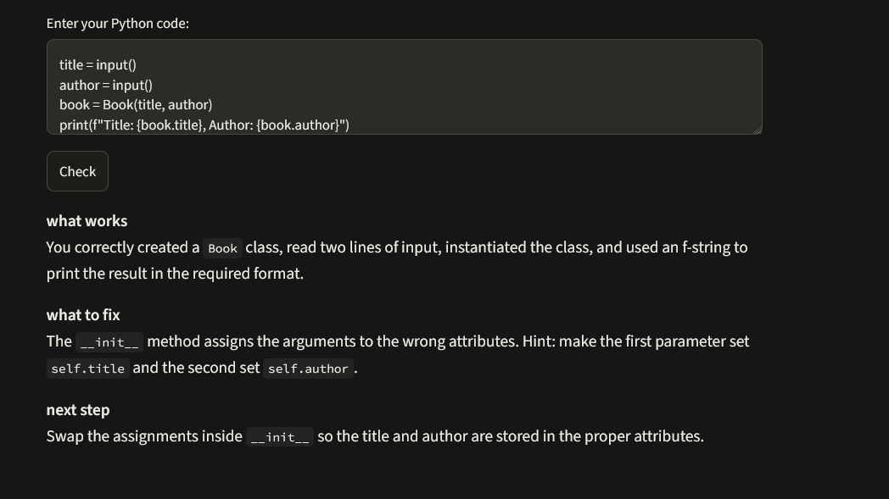

# Python Tutor

A simple programming tutor for students and people interested in learning Python.

## Screenshots









## Features

- **Explain:** type a Python concept and get a short, beginner-friendly explanation with a definition, an example, a common mistake and a check question.
- **Generate exercise:** pick a topic and a level (beginner, intermediate or advanced) and get one practice exercise with an example input and output.
- **Check code:** paste your solution and get feedback with one hint, without the full answer.

## How to run it

**You need:** Python 3.10 or newer, Git, and a free API key from [Groq](https://console.groq.com).

1. Clone the repository and go into the folder:

   ```
   git clone https://github.com/jacopozamagni/programming-tutor.git
   cd programming-tutor
   ```

2. Create and activate a virtual environment (Windows):

   ```
   py -m venv .venv
   .venv\Scripts\activate.bat
   ```

   On macOS or Linux, use `python3 -m venv .venv` and `source .venv/bin/activate`.

3. Install the libraries:

   ```
   pip install -r requirements.txt
   ```

4. Set your Groq API key as an environment variable. On Windows:

   ```
   setx GROQ_API_KEY "your-key-here"
   ```

   Then close the terminal, open a new one, and activate the environment again. On macOS or Linux, use `export GROQ_API_KEY="your-key-here"`.

5. Start the app:

   ```
   streamlit run app.py
   ```

   It opens in your browser.

**Note:** the app uses the model `openai/gpt-oss-120b`. If you get a "model not found" or "blocked" error, open your Groq project's limits page and make sure that model is allowed, or change `MODEL` in `test_api.py` to another chat model your account can use.

## How it works

The app is a Streamlit page (`app.py`) with three tabs. Each tab calls one function in `test_api.py` (`explain_concept`, `generate_exercise` or `check_code`), and all three use a single function, `ask_model`, which sends the request to the Groq API and returns only the answer text. The instructions given to the model (the prompts) are stored separately from the code, one per feature, so they can be edited and tested without changing the program. If a request fails, `ask_model` returns a friendly message and logs the real error.

## Limitations

- **The tutor can be wrong.** While testing, it once produced an advanced exercise whose example output (375) did not match its own explanation (405). Check the examples and exercises yourself.
- **It cannot run your code.** Feedback is based on reading the code, so it can miss or misdescribe a bug.
- **Quality varies with the topic.** Harder topics, such as trees or classes, sometimes ignore the length limits or use words a beginner does not know.
- **Free-tier rate limits.** Groq limits the number of requests per minute and per day for each model, so the app may stop answering for a while if it is used a lot.

## Future ideas

- Memory within a session (history of exercises and feedback)
- Support for more programming languages
- A "give me another hint" button that gets more specific each time
- Saving progress between sessions

